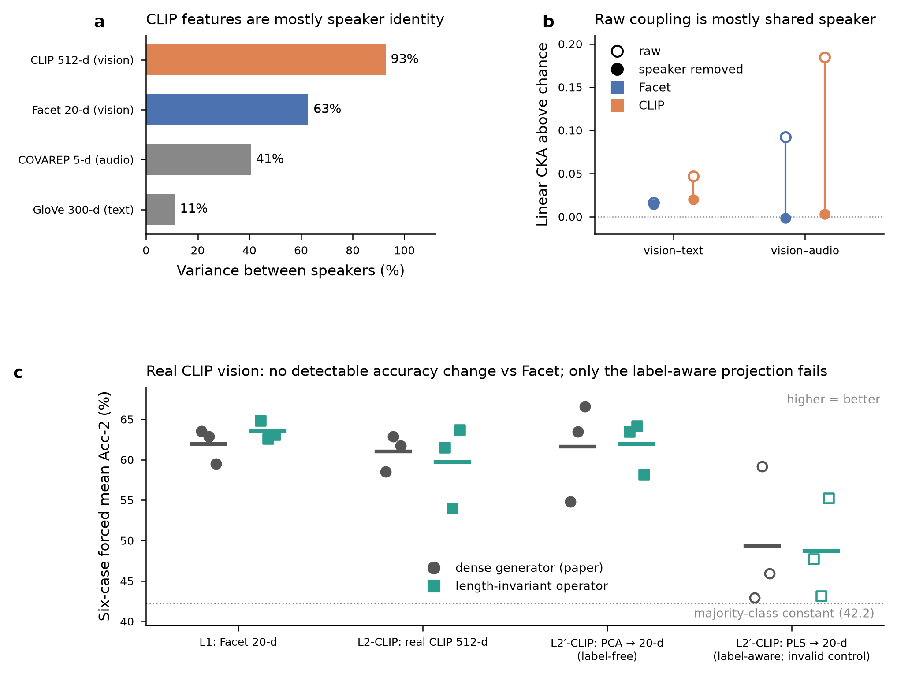

# SOP item 2 — CLIP visual extractor on real CMU-MOSI video: build, verification and results

*End-term, 31 Oct 2026. Box 10.50.21.144, repo `~/Downloads/ML-project/ML-Project`. Every number below is read from a committed run record or results file. Accuracy is the **six-case forced mean Acc-2** on the 686-sample test split. Runs use n = 3 seeds per arm; with 3 vs 3 the smallest exact two-sided permutation p is 0.10, and the binomial precision floor is 1.91 points.*



**Figure.** (a) Share of clip-level feature variance that lies between speakers (test split, 31 speakers). (b) Inter-modal linear CKA above a permutation null, on clip-level z-scored test features. Hollow = raw; filled = speaker removed (per-video centring, null permuted within video). For Facet–text the raw and centred values nearly coincide (0.0165 vs 0.0143). (c) Per-seed accuracy; bars = arm mean. Hollow markers = the label-aware PLS rung, which is an invalid control (see F5). The first, unscaled PLS build (all 3 dense seeds at the 42.2 constant) is omitted here and listed in the table.

## What was built (SOP §IV-D items 2 and 5)

| component | file | author |
|---|---|---|
| CLIP ViT-B/32 / ViT-L/14 extractor (OpenAI TorchScript weights, SHA-256 checked, frozen) | `lenmod/extractors/clip_extractor.py` | Sujal (d3f501c) |
| extraction driver (ffmpeg slicing, temporal pooling), merge utility, tests | `tools/extract_clip_features.py`, `tools/merge_multimodal_features.py`, `tests/test_clip_extractor.py` | Sujal (d3f501c) |
| hardening for the real run: MMSA clip layout; raise instead of a black frame on empty windows; native-resolution decode with CLIP's official preprocessing; segment IDs stored and asserted on merge; synthetic runs refused; meta sidecar; 2 new tests (8/8 pass) | same files | Ash (85eddde) |
| rung builders, verification and speaker-control scripts, PLS rescale, PCA control | `tools/build_clip_rungs.py`, `tools/verify_clip_features.py`, `tools/verify_clip_speaker_control.py`, `tools/rescale_l2pclip.py`, `tools/build_l2pcaclip.py` | Ash |

The SOP assigned the CLIP extractor and merge utility to Tanmay. The extractor code is Sujal's by git authorship, and the verification, real-data run and analysis are Ash's.

**Input data.** CMU-MOSI raw clips came from the MMSA Drive release: 2,199 clips, 93 videos. Matched against `data/mosi_data.pkl`: 2,199/2,199 segment IDs, 0 split mismatches, maximum label difference 0.0, and clip durations within 0.07 s of the reference end − start (61 sampled clips). The official CMU server timed out from the box.

**Extraction.** All 2,199 clips at 30 fps on the RTX 3060, in 1,079 s, with 0 failures; the hardened code raises on any empty window. Outputs:
- `data/mosi_clip_b32_native.pkl` (per-frame fp16; 7–1,575 frames per clip, median 94 train / 91 valid / 120.5 test);
- `data/mosi_clip_b32_v50_vision.pkl`.

Hashes are in `data/clip/SHA256SUMS`.

## Verification

| check | result |
|---|---|
| weights vs OpenAI SHA-256 | ViT-B/32 and ViT-L/14 match |
| extractor vs reference CLIP `encode_image` with official preprocessing, real 640×360 frame | cosine 0.99886 (0.951–0.986 before the preprocessing fix) |
| zero-shot scene, middle frame of all 2,199 clips | 2198/2,199 → "a photo of a person talking to the camera" |
| zero-shot "happy person" − "sad person" score vs sentiment label (test) | r = 0.166, p = 1.2e-05 |
| rung pickles | IDs asserted against the reference order in every split; upstream `MOSIData` loads both; CLIP rows placed in the text's word slots, agreeing with L1's Facet rows at 99.1–99.5% of positions |

## Findings

### F1 — Real CLIP features are mostly speaker identity
Between-speaker share of clip-level variance: CLIP 92.7%, Facet 62.8%, COVAREP 40.5%, GloVe 11.1%. MOSI's splits are speaker-independent (train/test overlap: 0 videos).
- **Raw ridge probe:** CLIP carries no sentiment that transfers to new speakers: test r = -0.004 (95% CI -0.074 to 0.070). Facet gives 0.178.
- **Speaker removed:** CLIP 0.072 (CI -0.005 to 0.149) vs Facet 0.032. This is descriptive only, since the CIs overlap.

### F2 — Real CLIP vision is not less correlated with the text than Facet
This tests the premise of the paper's Limitations section on real foundation features, for the vision modality. Raw coupling is mostly shared speaker identity:
- vision–audio excess falls from 0.185 to 0.003 for CLIP (p = 0.10), and from 0.092 to -0.001 for Facet (p = 0.65);
- within speakers, vision–text coupling is weak but real for both, and slightly higher for CLIP: 0.020 vs Facet 0.014 (both p = 0.002).

### F3 — Swapping Facet for real CLIP vision causes no detectable accuracy change
All rungs use the same launcher, protocol (complete-data validation, 200 epochs, when = 30) and commit; text and audio are identical across rungs.

| rung | vision | dense (paper) | invariant | invariant − dense |
|---|---|---:|---:|---:|
| L1 | Facet 20-d | 61.96 ± 2.15 | 63.51 ± 1.15 | +1.55 (exact p = 0.5) |
| L2-CLIP | real CLIP 512-d | 61.03 ± 2.25 | 59.73 ± 5.09 | -1.30 (exact p = 0.8) |
| L2′-CLIP | CLIP → PCA-20, label-free | 61.61 ± 6.10 | 61.95 ± 3.28 | +0.34 (exact p = 0.9) |
| *(invalid)* L2′-CLIP | CLIP → PLS-20, label-aware, rescaled | 49.34 ± 8.62 | 48.72 ± 6.11 | -0.62 (exact p = 1.0) |
| *(invalid)* L2′-CLIP | CLIP → PLS-20, label-aware, unscaled | 42.68 ± 0.79 | 48.64 ± 8.87 | — |

- **L1 → L2-CLIP:** dense -0.93 (exact p = 0.6); invariant -3.78 (exact p = 0.3).
- **L1 → L2′-CLIP (PCA):** dense -0.35 (exact p = 0.9); invariant -1.56 (exact p = 0.7).
- **Wording:** "no detectable change", never "equivalent".
- **Descriptive, one of many contrasts:** at L2-CLIP the invariant arm's text-present cases drop -10.37 (exact p = 0.1, complete rank separation), driven partly by seed 2 (53.99). It does not recur at L2′-CLIP PCA: -1.59 (exact p = 0.7).
- **Best epochs** come earlier on CLIP: mean 27 / 27 vs 53 / 45 at L1. This is consistent with F1, as the speaker signal is learned fast.

### F4 — Operator choice is irrelevant on real CLIP features too
Invariant − dense is null at L2-CLIP and at L2′-CLIP PCA, as on the length ladder.
- **The synthetic stressor's advantage does not replicate.** The +3.87 invariant win on the synthetic L2 noise rung does not appear on real CLIP features, so it is a property of injected orthogonal noise, not of foundation features.
- **Efficiency is not the point at these rungs.** At aligned length the invariant operator is slightly larger (L2-CLIP: 141,751 vs 132,421 trainable).

### F5 — The SOP's label-aware L2′ projection is an invalid control on MOSI (methodological finding)
PLS fitted to train labels, as the SOP prescribes, learns each training speaker's average sentiment.

| linear fit to label | train r | valid r | test r | train speaker-level r |
|---|---:|---:|---:|---:|
| CLIP → PLS-20 | 0.673 | 0.006 | 0.029 | 0.991 |
| synthetic L2′ (`tools/fit_l2_projection.py`) | 0.671 | −0.054 | 0.068 | 0.911 |
| CLIP → PCA-20, label-free | 0.345 | 0.200 | 0.053 | — |
| Facet 20-d | 0.341 | 0.237 | 0.178 | 0.615 |

- **Two flaws act together.** The PLS scores were also about 13× Facet's scale: median row norm 13.7 vs 1.07.
- **Unscaled build:** all 3 dense seeds landed at or near the 42.23 majority-class constant (best epochs 1–2).
- **Rescaled build:** still 49.34 ± 8.62 / 48.72 ± 6.11, with text-present cases down 18–25 points. The model uses the vision shortcut and ignores the text.
- **The label-free PCA control, at the same dimension and scale, trains normally.** So the failure is the label shortcut, not CLIP and not dimensionality.
- **The synthetic L2′ rung shares the same flaw**, which plausibly explains its unstable seeds (not separately tested).
- **Rule going forward:** dimension-matched controls on speaker-independent splits must be label-free, or fitted with speaker-grouped cross-fitting.

## SOP Table III reading (vision modality only)
- **Accuracy:** stable at L2-CLIP and L2′-CLIP PCA (F3).
- **Real-frame generation fidelity:** unchanged. Masked a/v CKA for the dense arm is 0.026 at L1 and 0.026 at L2-CLIP.
- **Inter-modal coupling:** not lower (F2).
- **Matching row:** "G, A both stable → concern unfounded" for vision.
- **Not tested:** margin M (no backbone-only control), and audio, which was not extracted (COVAREP throughout).

## Deviations and limits
- Only vision is a foundation feature. Audio stays COVAREP 5-d, so the rung mixes pipelines (CLIP vision + COVAREP audio + GloVe text), which the SOP asked us to avoid.
- The frozen backbone (`pretrained/mosei.pt`) was pre-trained on Facet-style MOSEI features. Only the input projection learns the new features.
- The word-slot layout uses a uniform per-clip split of frames, not P2FA word timestamps. Agreement with L1's Facet rows is 99.1–99.5%.
- Validation selects on complete data (`--valid_drop_rate 0.0`), the same as the synthetic L2 grid but not the drop-0.7 selection of the length ladder.
- The PCA control was added after the PLS failure, outside the approved plan. Both PLS builds are kept on disk as evidence.
- `missing_type_prompt_all_zeros` is true in all 30 runs (dead missing-type prompt).

## Files
- [clip_rungs_runs.csv](clip_rungs_runs.csv) — all 30 runs: per-case accuracy, best epoch, parameters, commit, data path, audit fidelity.
- [clip_rungs_tests.csv](clip_rungs_tests.csv) — every contrast with exact p, rank separation, and multiple of the precision floor.
- [CLIP_EXTRACTOR_VERIFICATION.md](CLIP_EXTRACTOR_VERIFICATION.md (artifact, not in repo)) — the pre-run code verification (30 Oct).
- On the box: `results/clip_feature_checks.json`, `results/clip_feature_checks_speaker_control.json`, `results/fidelity_audit_clip{,2,3}.json`, `runs_e200/mosi_{l1,l2clip,l2pclip,l2pclipsc,l2pcaclip}_*_cdval/`.

## Reproduce
```
.venv/bin/python tools/extract_clip_features.py --video_dir <MOSI>/Raw --reference_pkl data/mosi_data.pkl \
    --output_path data/mosi_clip_b32_v50_vision.pkl --native_out data/mosi_clip_b32_native.pkl --model ViT-B/32 --seq_len 50 --fps 30
.venv/bin/python tools/verify_clip_features.py && .venv/bin/python tools/verify_clip_speaker_control.py
.venv/bin/python tools/build_clip_rungs.py && .venv/bin/python tools/rescale_l2pclip.py && .venv/bin/python tools/build_l2pcaclip.py
bash runs_e200/supervisor_clip.sh; bash runs_e200/supervisor_clip2.sh; bash runs_e200/supervisor_clip3.sh
```
